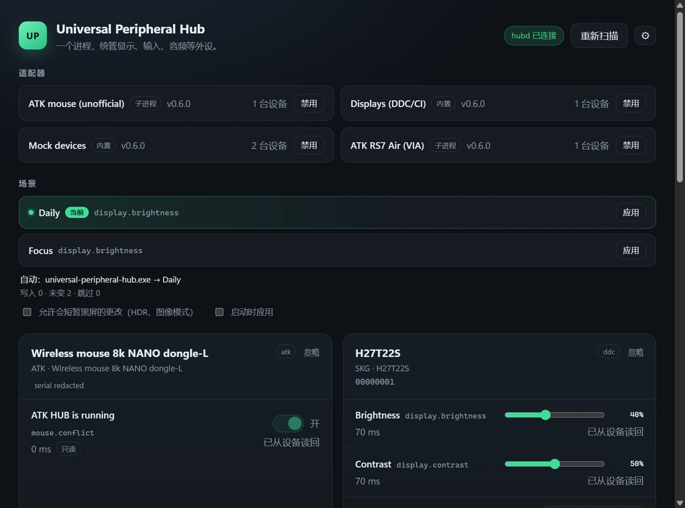
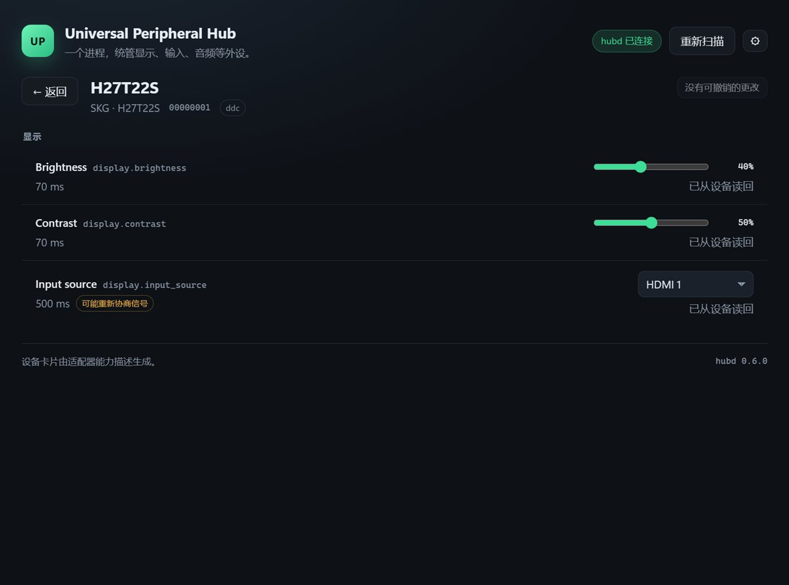
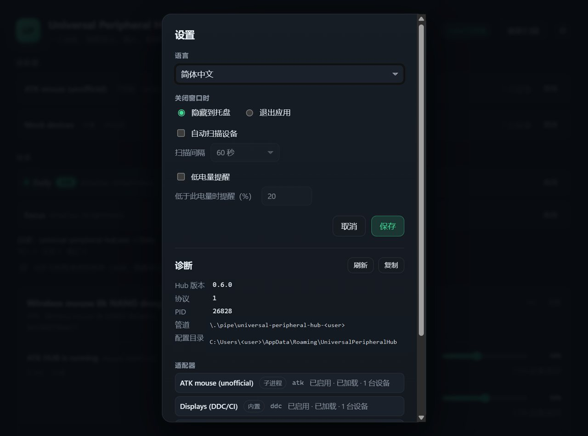

# Universal Peripheral Hub

One Windows application for monitors, keyboards, mice, headsets and controllers,
instead of one vendor utility per device.

The hub is a resident core process (`hubd`) plus a web-technology UI. Devices are
described by adapters as a set of typed **capabilities** (brightness, polling
rate, RGB, HDR, ...); the UI and the scene engine are generated from those
descriptors rather than hard-coded per vendor.

> **Status: M5 (adapters).** Panel, resident core, DDC/CI adapter, scene engine
> and two out-of-process ATK adapters are implemented. The mouse adapter
> (`adapters/atk`) reads battery, charging state, wireless link, firmware
> version, report rate and the active DPI slot; report rate and the DPI slot are
> writable. Numeric DPI is not advertised because the firmware does not expose
> the per-slot values. The keyboard adapter (`adapters/via`) speaks VIA/QMK and
> reports the protocol version, keymap layer count, key count (96 on the RS7 Air)
> and macro count, and exposes the keymap itself: the panel shows one button per
> key, a keycode picker, and writes the edited image back through the normal
> capability path (4 layers x 96 keys). Only changed keycodes are sent; the
> adapter reads the image back and restores the original if the board disagrees,
> and keeps the pre-edit image in `%APPDATA%\UniversalPeripheralHub\keymap-backups\`. Lighting is not
> implemented: this firmware answers the lighting read with `0xFF`. The headset uses a separate channel (USB audio plus
> a serial port) and is *not implemented* rather than faked.
> ATK HUB does not have to be closed: reads returned real values while it was
> running in our tests. If the mouse control collection goes silent (the vendor
> tool holding it, or an idle wireless mouse), the panel says so and `Rescan`
> rebuilds the adapters; moving the mouse once is usually enough. Auto-start
> and a per-user installer ship with 0.4.0; code signing does not. The panel has
> a settings page (language, close-to-tray, auto scan interval, low-battery
> alerts) in English, 简体中文 and 繁體中文, and shows a device's battery as a ring
> next to its name instead of a slider.



| Device detail | Settings and diagnostics |
| --- | --- |
|  |  |

Everything above is generated from capability descriptors: the panel has no
per-vendor layout code. See `docs/architecture.md` for the model and
`docs/screenshots/` for the originals.

> **Unofficial.** This project is not affiliated with or endorsed by any vendor.
> Device support is built from public documentation and from read-only
> observation of hardware we own; no vendor code or binaries are included. See
> `NOTICE.md` for the interoperability statement and prior art.

## Status / roadmap

| Milestone | Content | State |
| --- | --- | --- |
| M0 | Tauri shell, `hubd`, adapter host, mock adapter, RPC, CI | **done** |
| M1 | DDC/CI adapter (brightness, contrast, input, HDR) | **done** (HDR where advertised) |
| M2 | Scene engine (foreground trigger, read-before-write) | **done** (side-effect control untested on hardware) |
| M3 | HID adapters (ATK mouse, VIA keyboard) | **partial** (mouse read/write; keyboard read + keymap editing; headset not) |
| M4 | Full panel UI | **done** (device detail pages, undo, Ctrl+Alt+M, diagnostics, confirmations, retry, keyboard navigation) |
| M5 | Adapter trace record / replay | **partial** (adapters only; no user-side macro recording) |
| M6 | Packaging, auto-start, signing | **partial** (unsigned per-user NSIS installer, auto-start) |
| M7 | Public release | not implemented |

## Architecture in one paragraph

`hubd` owns adapters, devices, settings, the tray icon and the single-instance
mutex. The UI is a Tauri window that talks to `hubd` over a per-user named pipe
using newline-delimited JSON-RPC 2.0; it holds no device state of its own. An
adapter enumerate call returns `DeviceDescriptor`s that carry
`CapabilityDescriptor`s (stable `cap_type` + adapter-local `id`, a value kind,
a cost model and traits such as `signal_renegotiation`). First-party adapters
run in-process; third-party or experimental adapters will run in a child process
over stdio. See [docs/architecture.md](docs/architecture.md) and
[docs/adapter-protocol.md](docs/adapter-protocol.md).

## Repository layout

```
crates/hub-core     descriptor model, adapter trait, in-process host, settings
crates/hub-proto    JSON-RPC wire types shared by hubd and the UI shell
crates/hubd         resident core: pipe server, tray, single instance, --selftest
adapters/mock       in-process mock adapter with two fake devices
ui/                 Vite + TypeScript frontend
ui/src-tauri        Tauri 2 shell (window only; no tray, no device logic)
docs/               architecture, decisions, adapter protocol
data/monitors/      per-EDID monitor overrides (SKG2725.json = KTC H27T22S)
data/scenes.example.json  documented example scene document
```

## Install

**[Download the latest release](https://github.com/awaaww/universal-peripheral-hub/releases/latest)** — a per-user installer, no administrator rights required.

The per-user installer from the release page
(`Universal Peripheral Hub_*_x64-setup.exe`) needs no elevation: it unpacks the
core and the adapters into `%LOCALAPPDATA%\Universal Peripheral Hub\`, registers
auto-start for the current user and starts the tray process. Uninstalling
removes the program and the auto-start value but keeps
`%APPDATA%\UniversalPeripheralHub\` (settings, scenes, keymap backups) so a
reinstall picks up where it left off.

The panel's gear button opens a settings page:

- **Language** — English, 简体中文, 繁體中文. The tray menu and battery alerts
  follow the same preference.
- **Close button** — hide to the tray (the core keeps running) or quit both
  processes.
- **Auto scan** — rebuild every adapter every 15–300 s. Off by default; the
  `Rescan` button and the startup scan work regardless.
- **Low battery** — a tray notification when a device drops to or below a
  percentage you pick; it fires once and re-arms after the battery recovers.

Preferences live in `%APPDATA%\UniversalPeripheralHub\settings.json` under
`prefs`, and `hubd` normalizes anything out of range.

Auto-start is a per-user `Run` value. Toggle it from the tray menu
("Start with Windows") or headlessly:

```powershell
hubd.exe --autostart on
hubd.exe --autostart status
hubd.exe --autostart off
```

To build the installer yourself:

```powershell
cd ui
npm run build
npm run tauri build
# -> target\release\bundle\nsis\Universal Peripheral Hub_<version>_x64-setup.exe
```

`ui/src-tauri/bin/` must contain `hubd.exe`, `atk-adapter.exe` and
`via-adapter.exe` (release builds). The NSIS bundler is downloaded by the Tauri
CLI on first use; it needs about 3 MB of disk and no network afterwards.

## Build and run

Prerequisites: Rust stable (MSVC toolchain), Node.js 20+, WebView2 runtime
(preinstalled on Windows 10 1809+ / Windows 11).

Development (the shell loads the Vite dev server, so start it through Tauri):

```powershell
# terminal 1 — core process: tray icon appears, right-click for the menu
cargo run -p hubd

# terminal 2 — panel with hot reload
cd ui
npm install
npm run tauri dev
```

Standalone binaries:

```powershell
cd ui; npm run build; cd ..
cargo build --release -p hubd
# The shell needs `custom-protocol` to embed ui/dist; without it, `tauri`
# proxies to the Vite dev server at http://localhost:1420 instead.
cargo build --release -p universal-peripheral-hub --features custom-protocol
target\release\hubd.exe                        # resident core, tray icon
target\release\universal-peripheral-hub.exe    # panel, starts hubd if needed
```

`npm run tauri dev` builds the shell in dev mode (dev server, hot reload);
`npm run tauri build` enables `custom-protocol` and embeds `ui/dist`.

Headless smoke test, no window, no tray:

```powershell
cargo run -p hubd -- --selftest
```

It loads the mock adapter, prints the two device descriptors as JSON, unloads and
reloads the adapter, and exits with code 0.

The real HID adapters have their own smoke test, which enumerates the helper and
prints every live capability value:

```powershell
cargo run -p hubd -- --selftest --adapter atk    # ATK wireless mouse
cargo run -p hubd -- --selftest --adapter via    # ATK RS7 Air keyboard (VIA/QMK)
```

Both exit non-zero when the helper binary is missing or no device answers.

Configuration lives in `%APPDATA%\UniversalPeripheralHub\settings.json`. Writes
are atomic; an unparsable file is preserved as `settings.json.corrupt-<timestamp>`
and replaced with defaults.

The first keymap edit copies the board's keymap image (768 bytes) to
`%APPDATA%\UniversalPeripheralHub\keymap-backups\via-<serial>-<timestamp>.bin`
before any frame is sent. Restoring a backup is a manual `keyboard.keymap` write:
the file is the raw big-endian keymap, no header.

## Design principles

1. **Descriptors, not hard-coded controls.** The UI renders whatever the adapter
   describes; adding a capability must not require UI changes.
2. **Read before write.** Every write is followed by a read-back; a scene only
   writes values that differ from the current state.
3. **Renegotiation is opt-in.** Capabilities that can blank the screen or change
   the signal (HDR, image mode, display application, colour temperature) are
   marked `signal_renegotiation` and never applied implicitly.
4. **No shell code.** Every module in this repository either works or is marked
   as not implemented. There are no placeholder commands that silently do nothing.
5. **Offline by default.** The hub makes no network requests.

## 中文摘要

通用外设中心：用一个常驻核心进程 `hubd` 加一个 Web 技术界面，取代显示器、键盘、鼠标、
耳机、手柄各自的厂商驱动软件。适配器把设备描述成一组带类型的「能力」（亮度、回报率、
RGB、HDR 等），界面和场景引擎都从描述符生成，而不是为每个型号写死控件。

当前是 **M1**：外壳、适配器宿主、RPC、描述符驱动的界面、模拟适配器，以及真实 DDC/CI
显示器适配器（亮度/对比度/输入源，HDR 视机型是否上报 VCP `0xE9`）可用。HID、音频适配器、
场景引擎、开机自启和安装包均**未实现**，状态表见上。

进程边界：`hubd` 拥有托盘、单实例、设置与设备；UI 只是一个窗口，通过按用户命名的
命名管道用「按行 JSON-RPC 2.0」与 `hubd` 通信，自身不保存设备状态。

## License

MIT. See [LICENSE](LICENSE) and [NOTICE.md](NOTICE.md). Prior art and protocol
references are acknowledged there; no source code from those projects is included.
